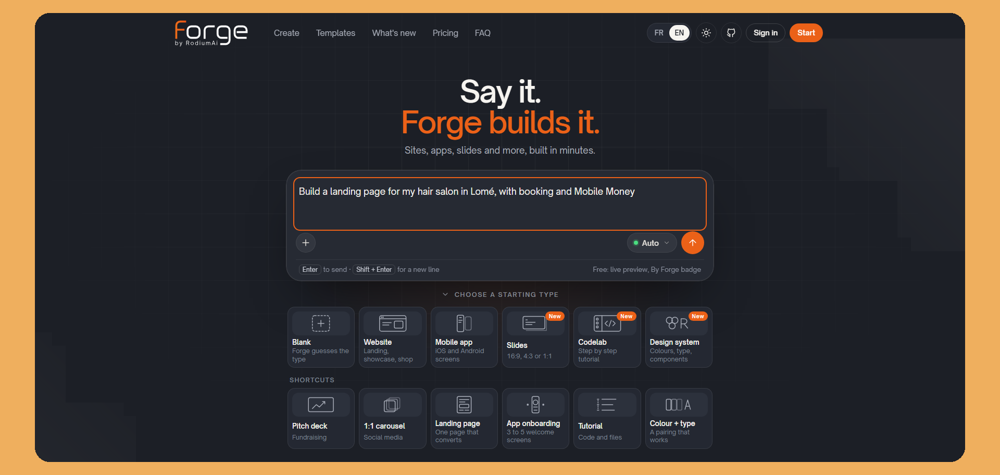
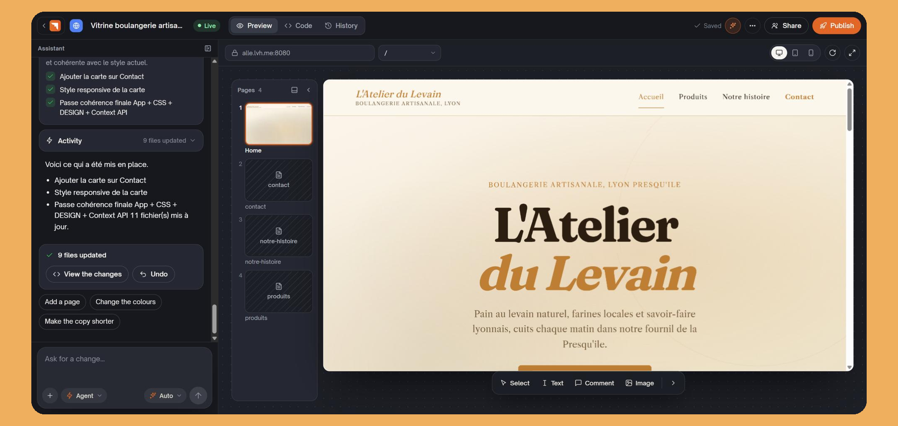
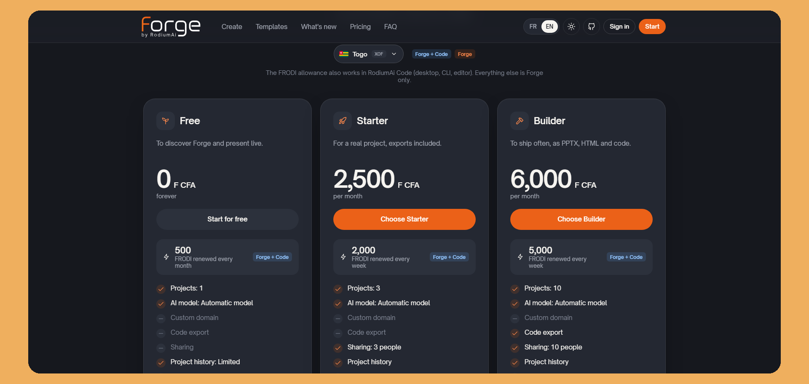

# Forge

<p align="center">
  
</p>

<p align="center">
  <a href="https://github.com/RodiumAi/Forge/actions/workflows/ci.yml"></a>
  
  
  
  
  
  
  <a href="LICENSE"></a>
</p>

> 🇫🇷 [Version française](README.fr.md)

Forge is an open-source, AI-powered builder. Describe what you want in a chat and Forge builds it with you: websites and apps, slides, codelabs and design systems. Each project kind has its own editor, AI, templates, publishing and exports.

| Kind | What you get | How it is built |
| --- | --- | --- |
| **Web** | A website | Frontend-only React code written by the agent, previewed in the browser, published as a static ESM site |
| **App** | A mobile-style app | Same engine as Web, with mobile layout rules |
| **Slides** | A presentation deck | A JSON document rendered by the Forge deck player |
| **Codelab** | A step-by-step tutorial with code files | A JSON document rendered by the Forge codelab player |
| **Design system** | Tokens, components and brand guidelines | A JSON document rendered as a design system site |

Web and App are always available. Slides, Codelab and Design system are off by default on a self-hosted instance: see [Turning on the project kinds](#turning-on-the-project-kinds).

## Two modes

| | **Self-host (this repo)** | **Forge Cloud** ([forge.rodiumai.io](https://forge.rodiumai.io)) |
| --- | --- | --- |
| **Accounts** | Local email/password (+ optional Google, optional RodiumAi OIDC) | RodiumAi SSO (OIDC) |
| **Credits** | Paste your own RodiumAi API key (`rd_sk_…`) | **FRODI** first (plan allotment), **RODI** wallet as fallback |
| **Free tier** | Bring your own key | **500 FRODI / month** on Free |
| **Plans / billing** | None | Forge plans managed by the RodiumAi control plane |
| **Templates, exports** | All of them, no plan check | Follow the account's plan |

Self-host never depends on a service you cannot run. Cloud entitlements and plan grants live in the RodiumAi control plane (Nest). This repo only reads them, through `/auth/forge/status` and the gateway's `/internal/forge/balance`.

## Architecture

```
Forge/
├── apps/
│   ├── web/             # Next.js 15 + TypeScript: builder UI and document editors
│   └── api/             # FastAPI + SQLAlchemy + Postgres: API, agent, orchestration
│       ├── app/kinds/   # Project kind registry (web, mobile, slides, codelab, design_system)
│       └── runtime/     # In-browser Babel runner (pure JS) + packages.json manifest
│           ├── deck/    # Deck player bundle and PPTX export (Node)
│           └── codelab/ # Codelab player build (Node)
├── data/
│   ├── templates/       # 86 starter kits (see docs/TEMPLATES.md)
│   └── integrations/    # Embed catalog (see docs/INTEGRATIONS.md)
└── infra/               # Docker local + CI helpers
```

The 86 kits in `data/templates/`, by the `kind` field of their `template.json`:

| `kind` | Kits |
| --- | --- |
| `web` | 24 |
| `mobile` (App) | 12 |
| `slides` | 36 |
| `codelab` | 8 |
| `design_system` | 6 |

Supporting services: **MinIO** (S3 uploads and published files), **Valkey** (run queue, cancellation), **Caddy** (published sites at `*.lvh.me:8080`), **Mailpit** (local mail), **Adminer** (DB console). LLM calls go through the **RodiumAi** gateway.

There are no migration files: the API applies an idempotent schema (`apps/api/app/db.py`) each time it starts.

## Key features

### Sites and apps

- **Chat-to-site**: describe a site or app; the agent generates a frontend-only React project.
- **Instant preview**: in-browser Babel/ESM runner with a CDN import map (esm.sh). No node_modules, no Vite.
- **Publishing**: production build (bundled, minified, hashed, dependencies embedded), every route pre-rendered with its own title and meta, `404.html`, sitemap, robots, structured data and cache headers, served by Caddy.
- **Brand charter on the first build**: palette, Google Fonts pairing and imagery from the brief, plus the first generated images (WebP + srcset).
- **Visual editing**: text and images, directly on the preview, with the Forge context menu.
- **Image panel**: generated images, uploads, and an optional free image bank (Pixabay, searched server side).
- **History and rollback**: per-project git snapshots.
- **ZIP export**: a real, runnable Vite project.
- **Design system link**: a site or app can follow a design system version; a newer version is only applied after you confirm the resync.
- **Asset vs reference attachments**: logos land in `public/`; screenshots guide layout. Paste a site URL to capture desktop and mobile references (Playwright).
- **Integrations catalog**: drop-in embeds, see [docs/INTEGRATIONS.md](docs/INTEGRATIONS.md).
- **Runtime manifest**: `packages.json` is the single source of truth for the import map, the AST allowlist and the Monaco types.

### Slides

- **Deck editor**: slide rail, canvas, layers panel, properties panel and format toolbar.
- **Deck AI**: outline, layouts, targeted edits, themes and visuals from the deck chat, with voice input.
- **Import**: attach a PowerPoint (`.pptx`) or PDF file to the deck chat.
- **Present and publish**: present mode and a published deck player.
- **Exports**: PDF, PNG, HTML and PPTX (the Node runtime in `apps/api/runtime/deck/` builds the player bundle and the PPTX).

### Codelabs

- **Step editor** with AI, plus starter and solution files.
- **Player and publishing**: a published codelab player.
- **Import and export**: Markdown in and out (claat-compatible), PDF and ZIP export.

### Design systems

- **Tokens, components and brand guidelines**, generated and edited with AI.
- **Exports**: `tokens.json` (W3C format), CSS variables, Tailwind, brand guidelines (Markdown, PDF).
- **Sharing**: share a design system with your team.

### Across kinds

- **Templates**: 36 site and app kits, 36 slides kits, 8 codelabs and 6 design systems. See [docs/TEMPLATES.md](docs/TEMPLATES.md).
- **Collaboration**: invite collaborators on a project.
- **FRODI badge (Cloud)**: plan and FRODI balance in the sidebar; RODI when FRODI is exhausted or unset.

<p align="center">
  
</p>

## Plans (Forge Cloud)

**FRODI first**, RODI when you need more. FRODI are Forge credits (weekly on paid plans, monthly on Free) and expire; RODI stay in the RodiumAi wallet. Free includes 500 FRODI a month.

<p align="center">
  
</p>

The plan catalog (prices, allotments, features) is served by the RodiumAi control plane; the builder only displays the entitlements and spends them. On Cloud, the plan decides which templates can start a project and which export formats are available. A self-hosted instance has no plan and applies none of these limits.

## Prerequisites

| Tool | Version | Needed for |
| --- | --- | --- |
| Docker + Compose v2 | any current release | the quick start below |
| Node.js | **22** (`.nvmrc`) | running `apps/web` and the runtimes on the host |
| Python | **3.12** (`.python-version`) | running `apps/api` on the host |

CI runs on exactly these versions. Older runtimes may build locally and still
fail CI: `ruff` targets `py312` and several dependencies are version-sensitive.

> **Self-host sign-in works out of the box.** Create a local account at
> `/register` (email/password). Optional Google needs Firebase env vars.
> **"Continue with RodiumAi"** appears only when `RODIUM_OIDC_CLIENT_ID` is set;
> leave it empty and the button stays hidden. On Forge Cloud, OIDC SSO is the
> primary path and the Free plan is granted by the control plane.

## Quick start (Docker)

```bash
cp .env.example .env
make up          # docker compose up -d --build, then make migrate
```

Without `make`:

```bash
cp .env.example .env
docker compose up -d --build
```

The API applies the schema when it starts; `make migrate` runs the same step
again by hand.

| Service | URL |
| --- | --- |
| Builder UI | http://localhost:3100 |
| API docs | http://localhost:8100/docs |
| Published sites | http://\<slug\>.lvh.me:8080 |
| MinIO console | http://localhost:9001 |
| Adminer | http://localhost:8089 |
| Mail (Mailpit) | http://localhost:8026 |

[DOCKER.md](DOCKER.md) lists every service, port and `make` target.

## First run: account and generation key

**1. Create an account.** Open http://localhost:3100/register and sign up. You
are signed in immediately.

**2. Confirm your email.** The stack ships a Mailpit container, so mail is
real; it just never leaves your machine. Open **http://localhost:8026** and
the confirmation message is waiting, link included. Password reset works the
same way.

Running the API on the host instead of in Docker? `mailpit` does not resolve
there, so set `MAIL_TRANSPORT=console` and the links are printed in the API
log. Set `MAIL_TRANSPORT=ses` (plus the `AWS_*` credentials) for real delivery.

**3. Add a generation key (self-host).** Forge does not ship a model; you bring
the credentials for one. Create a free account on
[rodiumai.io](https://rodiumai.io), copy an API key (`rd_sk_prod_…`), and paste
it in Forge under **Settings → RodiumAi connection**. The **Test API** button
checks it before you rely on it.

On **Forge Cloud**, linked accounts use their plan (FRODI) instead of a pasted
key; the sidebar shows the balance.

`RODIUM_BASE_URL` must match where that key is valid. The shipped default,
`https://api.rodiumai.io/v1`, is right for a key from rodiumai.io; change it
only if you run your own gateway.

Google sign-in is optional: fill in the `FIREBASE_*` (API) and
`NEXT_PUBLIC_FIREBASE_*` (web build) values to show the Google button on
`/login` and `/register`. Leave them empty and the button is not rendered.
Enable **Google** in the Firebase console and add your domain under
Authorized domains. GitHub sign-in is not offered.

## Configuration

Copy `.env.example` to `.env` and adjust it. It documents the essential
variables (database, MinIO, Valkey, RodiumAi gateway, OIDC, mail, models).
`apps/api` and `apps/web` each carry their own `.env.example` for host-run
development.

### Turning on the project kinds

Slides, Codelab and Design system ship off. Each one has an API setting, read
from the environment (`apps/api/app/config.py`):

| Variable | Kind |
| --- | --- |
| `FORGE_KIND_SLIDES_ENABLED` | Slides |
| `FORGE_KIND_CODELAB_ENABLED` | Codelab |
| `FORGE_KIND_DESIGN_SYSTEM_ENABLED` | Design system |

Uncomment the ones you want in `.env`, set them to `true`, then recreate the
API container so it picks up the new values:

```bash
docker compose up -d api
```

The web app asks the API which kinds are on (`GET /kinds`), so nothing changes
on the web side. A kind that is off cannot be created. Web and App are always on.

### Free image bank (optional)

`PIXABAY_API_KEY` turns on the free image search in the image panel. Get a key
from [pixabay.com/api/docs](https://pixabay.com/api/docs/). It stays on the
server and is never sent to the browser. Leave it empty and that search answers
`503`; generated images and uploads still work.

## Hybrid development (Docker infra + local api/web)

Run infra with Docker, then run the API and/or web app locally.

**API**

```bash
cd apps/api
python -m venv .venv && source .venv/bin/activate   # Windows: .venv\Scripts\activate
pip install --require-hashes -r requirements-dev.txt # runtime deps + ruff + pytest
cp .env.example .env
uvicorn app.main:app --reload --port 8100
```

**Web**

```bash
cd apps/web
npm install
npm run dev   # port 3100
```

## Tests and checks

These are the commands CI runs (`.github/workflows/ci.yml`), so a green local
run means a green pipeline.

```bash
# apps/web
npm run lint && npm run typecheck && npm test
FORGE_FONT_MODE=fallback npm run build

# apps/api  (TEMPLATES_ROOT → data/templates, INTEGRATIONS_ROOT → data/integrations; see CONTRIBUTING)
# CI runs `npm ci` in apps/api/runtime and apps/api/runtime/deck before these.
ruff check app tests && ruff format --check app tests
pytest -q

# apps/api/runtime
npm ci && npm test

# apps/api/runtime/deck
npm ci && npm test

# repository root: the import map and the AST allowlist must agree
python infra/ci/check_manifest_parity.py
```

## Contributing

Contributions are welcome. [CONTRIBUTING.md](CONTRIBUTING.md) covers the dev
setup, the checks to run before pushing, the PR process, and how to submit a
template or integration kit. Please also read the [Code of Conduct](CODE_OF_CONDUCT.md).

By contributing, you agree that your contributions are licensed under the MIT
License that covers this project.

## Documentation

- [docs/README.md](docs/README.md): index of the public docs, English and French
- [docs/ARCHITECTURE.md](docs/ARCHITECTURE.md): how a run, the preview and publishing work
- [CONTRIBUTING.md](CONTRIBUTING.md): dev setup, checks, PR guide, templates and integrations
- [docs/TEMPLATES.md](docs/TEMPLATES.md): template authoring contract
- [docs/INTEGRATIONS.md](docs/INTEGRATIONS.md): embed catalog contract
- [DOCKER.md](DOCKER.md): local stack, ports, API image
- [SUPPORT.md](SUPPORT.md): where to get help
- [SECURITY.md](SECURITY.md): how to report a vulnerability
- [CODE_OF_CONDUCT.md](CODE_OF_CONDUCT.md)
- [LICENSE](LICENSE): MIT
