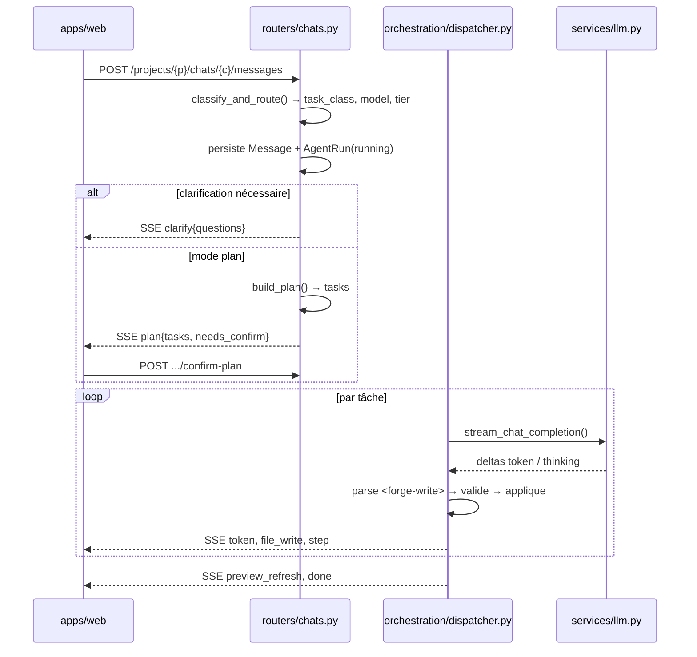

> 🇬🇧 [English version](ARCHITECTURE.md)

# Architecture

Comment Forge transforme un message de chat en site, en application, en
présentation, en codelab ou en design system, et où vit chaque pièce. Écrit
pour les contributeurs : chaque affirmation ci-dessous pointe vers un fichier
que vous pouvez ouvrir. C'est une vue d'ensemble, pas une référence d'API.

## En bref

```
apps/web      Next.js 15 App Router : UI du builder et des éditeurs, consommateur SSE
apps/api      FastAPI : routage, orchestration de l'agent, publication, exports
  runtime/          chaîne Babel/ESM Node + navigateur (partagée preview ET publication)
  runtime/deck/     bundle du lecteur de présentations et écriture PPTX (publication, exports)
  runtime/codelab/  bundle du lecteur de codelabs (publication, export PDF)
contracts/    forge-design/ : schémas JSON des types document
data/         templates/ (86 kits de départ) · integrations/ · projects/ (workspaces générés)
infra/        stack Docker locale · helpers CI · sites gateway AWS
```

Services d'appui : **Postgres**, **MinIO** (S3), **Valkey** (Redis), **Caddy**
(sert les sites publiés). Les appels LLM sortent vers le gateway RodiumAi.

Trois idées expliquent l'essentiel de la conception :

1. **Pas d'étape de build pour le code généré.** Les sites et applications
   générés ne sont jamais compilés côté serveur pendant le travail. Le
   navigateur les transforme avec Babel standalone et charge les dépendances
   depuis une import map CDN. Ni `node_modules`, ni serveur de développement
   Vite.
2. **Un manifeste, deux consommateurs.** `apps/api/runtime/packages.json` est
   l'unique source de vérité pour l'import map, la liste blanche d'imports et
   les types Monaco. Preview et publication lisent le *même* fichier via le
   *même* resolver.
3. **Aucun secret LLM dans le dépôt.** Sur Forge Cloud, la génération utilise le
   jeton OAuth de l'utilisateur et un **id** de clé API : le secret n'atteint
   jamais ce code. En self-host, on colle une clé BYOK `rd_sk_…` (chiffrée au
   repos) ; Cloud dépense d'abord les **FRODI**, puis les **RODI**.

## Types de projet

`Project.platform` stocke le type. Le registre est
`apps/api/app/kinds/__init__.py`, reflété par `apps/web/lib/kinds.ts` :

| Type | Moteur | Éditeur | Mode de publication | Exports | Drapeau |
|---|---|---|---|---|---|
| `web` | react | builder | `site` | zip | toujours actif |
| `mobile` | react | builder | `site` | zip | toujours actif |
| `slides` | document | deck | `deck_player` | pdf, png, pptx, html | `FORGE_KIND_SLIDES_ENABLED` |
| `codelab` | document | codelab | `codelab_player` | md, pdf, zip | `FORGE_KIND_CODELAB_ENABLED` |
| `design_system` | document | design_system | `design_system_site` | tokens, css, tailwind, md, pdf | `FORGE_KIND_DESIGN_SYSTEM_ENABLED` |

Les **types React** sont du code écrit par l'agent (les sections de « Un run
de génération » à « Publication » ci-dessous). Les **types document** sont des
données validées contre les contrats de `contracts/forge-design/`
(`deck.schema.json`, `slide.schema.json`, `codelab.schema.json`,
`design-system.schema.json` ; miroir Pydantic dans
`apps/api/app/contracts/forge_design.py`, miroir TypeScript dans
`apps/web/lib/contracts/forge-design.ts`) et rendues par un lecteur Forge fixe.
Le modèle n'écrit jamais de code pour eux : il répond du JSON ou du Markdown
que le serveur valide, répare si besoin, puis écrit.

Les trois types document **sont livrés désactivés**. Chaque drapeau vaut
`false` par défaut (`apps/api/app/config.py` ; commentés dans `.env.example` et
`apps/api/.env.example`). `GET /kinds` (`app/routers/kinds.py`) indique à
l'application web quels types sont actifs. Tant qu'un type est désactivé, la
création d'un projet de ce type échoue avec `KIND_DISABLED`, ses routes de
documents et d'export répondent 404, et ses kits de départ restent hors du
catalogue public de templates.

Un nouveau projet document part de `app/services/document_scaffold.py` (une
slide de titre, une étape d'introduction, ou les tokens par défaut, plus un
`DESIGN.md`), ou d'un kit de départ (voir [TEMPLATES.fr.md](TEMPLATES.fr.md)).

## Un run de génération, de bout en bout

Cette section et les quatre suivantes décrivent les types React (`web`,
`mobile`).



**Points d'entrée.** L'UI poste depuis `apps/web/app/projects/[id]/page.tsx` et
replie chaque événement via `apps/web/lib/chat-stream.ts` (`reduceStreamEvent`
renvoie `{state, effects}` ; la page exécute les effets). Côté serveur, c'est
`apps/api/app/routers/chats.py` (`send_message`). Un message sur un projet
document est confié à `start_document_message`
(`app/services/deck_ai/chat_entry.py`) avant le pipeline des sites ; sinon
l'une des quatre branches s'exécute : image, clarify, passe unique, ou plan.

**Streaming.** Tout passe en SSE, enveloppé par `with_sse_heartbeats`
(`apps/api/app/services/sse.py`), qui émet des commentaires `: hb <ts>` pour
qu'un run silencieux ne soit pas coupé par un proxy. Portez
`ALB_IDLE_TIMEOUT_SECONDS` (600 par défaut) au niveau de votre load balancer.

**Contrat d'événements.** Chaque trame est `data: <json>` :

| `type` | Signification |
|---|---|
| `user_message` | poignée de main sur l'id du run |
| `route` | décision de routage (classe de tâche, palier) |
| `step`, `plan`, `plan_task` | panneau d'activité et checklist du plan |
| `token`, `thinking` | deltas de texte / de raisonnement |
| `clarify` | point d'arrêt humain ; libère le composer |
| `file_write`, `file_delete` | une opération a été appliquée |
| `preview_refresh` | émis aux frontières de tâches, pas à chaque écriture |
| `warning` | remontée du validateur ou de la vérification |
| `error`, `done` | terminal |

**Les reconnexions sont un cas de première classe.** Un run est produit par une
tâche de fond, pas par le handler HTTP : fermer l'onglet ne le tue pas.
`GET .../runs/active` restaure l'état, `GET .../runs/{id}/events?after=N`
rejoue puis suit.

**L'appel LLM** est du `httpx` brut vers un `/chat/completions` compatible
OpenAI, sans SDK fournisseur. Voir `apps/api/app/services/llm.py`.

## La boucle de l'agent

**Forge n'utilise pas le function calling.** Le modèle écrit des balises XML
dans sa sortie normale et le serveur les analyse (`apps/api/app/prompts/system.py`
définit le contrat, `apps/api/app/services/tags.py` l'analyse) :

```
<forge-write path="src/App.tsx"> …contenu du fichier… </forge-write>
<forge-edit path="src/App.tsx">
<<<<<<< SEARCH
lignes actuelles exactes
=======
lignes de remplacement
>>>>>>> REPLACE
</forge-edit>
<forge-delete path="src/Old.tsx"></forge-delete>
```

`forge-edit` applique des blocs chercher/remplacer au fichier courant
(`services/edit_apply.py` : correspondance exacte, puis ligne à ligne tolérante
aux espaces, jamais ambiguë) ; une modification qui ne s'applique pas a droit à
une relance ciblée avec le fichier montré en entier.

**Limites de sortie.** Chaque flux de code envoie `max_tokens` (sinon la
passerelle plafonne Claude/Gemini à 4096 tokens) et lit `finish_reason`. Une
réponse coupée par la limite, ou une balise restée ouverte, est poursuivie
(`stream_with_continuation` dans `services/llm.py`) : le fichier réémis remplace
la version coupée, et un fichier encore coupé après le dernier tour est signalé
à l'utilisateur au lieu de disparaître.

Conséquence à connaître : **l'agent ne choisit pas les fichiers qu'il lit.** La
constitution du contexte est heuristique :
`apps/api/app/services/orchestration/context.py` sélectionne par pertinence,
chemins forcés et `files` déclarés par le plan (les dossiers sont développés en
fichiers), puis superpose le prompt système, `AI_RULES.md`, un `DESIGN.md`
verrouillé, les images du projet avec leurs vraies dimensions, un extrait de kit
comme référence de qualité sur les jeunes builds, les squelettes de fichiers
(les CSS listent leurs classes) et les corps sélectionnés (160k caractères,
index.css d'abord). L'historique ancien est compacté par une passe LLM. Les
règles « frontend uniquement » et le catalogue d'intégrations viennent de
`services/prototype_mode.py`.

Phases : classification → clarification éventuelle → plan → amorçage de marque
(premier build d'un projet vierge : `services/brand_charter.py` écrit un
DESIGN.md avec palette, paire Google Fonts validée et direction d'images, puis
les premières images WebP) → exécution → vérification/réparation (sur le modèle
qui a écrit le code). Les plans de quatre tâches ou plus, et tout scaffold,
s'arrêtent pour confirmation.
`apps/api/app/services/orchestration/dispatcher.py` exécute les tâches l'une
après l'autre.

**Une seule règle CSS partout** : `src/index.css` est la fondation, écrite une
fois par la tâche styles_foundation ; chaque page possède `src/styles/<page>.css`,
scopé sous sa classe racine. Les classes orphelines sont signalées sur le
composant et sa feuille de style.

**Les écritures sont validées avant que quoi que ce soit touche le disque**
(`apps/api/app/services/apply_writes.py`) :

- Un **snapshot git** est pris d'abord : chaque projet est son propre dépôt
  privé sous `data/projects/{id}`, ce qui alimente l'historique et le rollback.
- Les imports sont vérifiés contre la liste blanche du manifeste via
  **tree-sitter** (`services/import_validator.py`), avec repli sur des regex.
  Violations : `BUILD_FORBIDDEN_IMPORT`, `BUILD_INVALID_NAMED_EXPORT`.
- `DESIGN.md` et `public/logo.*` sont verrouillés sauf demande explicite de
  changer la marque ; la charte provisoire d'un scaffold vierge n'est pas une
  marque et n'est jamais verrouillée.
- Une réécriture complète de `src/index.css` qui perd des règles les conserve
  (fusion) ; les suppressions voulues passent par `forge-edit`. Les feuilles de
  page appartiennent à leur tâche et se réécrivent librement.

## Preview

Aucun serveur de développement n'est démarré. `GET /runner/` rend une coquille
(`apps/api/app/services/preview_babel.py`) qui injecte l'import map, les origines
parentes autorisées et Babel standalone. L'UI récupère ensuite le bundle source
et poste `{type:"forge:render", files, entry}` dans l'iframe.

Dans l'iframe (`apps/api/runtime/`) :

1. `transform.mjs` : Babel avec les presets React (runtime automatique) + TypeScript.
2. Les specifiers nus sont vérifiés contre l'import map du document → `IMPORT_NOT_IN_MANIFEST`.
   La collecte d'imports utilise des regex strictes (pas de guillemets entre
   `import`/`export` et `from`) plus un filtre de plausibilité, pour qu'un
   fragment Babel du type `/*#__PURE__*/_jsxs` ou le mot `from` dans une chaîne
   (`"or start from"`) ne soit jamais pris pour un package.
3. `topo.mjs` : tri topologique, levant `CIRCULAR_DEPENDENCY` avec le cycle.
4. `rewrite.mjs` + `resolve.mjs` : chaque specifier est réécrit vers l'URL `blob:` déjà créée de sa dépendance. La résolution est **sensible à la casse** et comprend `@/` → `src/`.
5. `await import(entryBlobUrl)`. Les anciens blobs sont révoqués en cas de succès, conservés en cas d'échec pour que l'erreur reste inspectable.

L'import map n'est pas modifiable après chargement : c'est pourquoi les
dépendances propres au projet doivent être injectées au rendu de la coquille
(`?p=<uuid>`). Incrémentez le `?v=` de `runner.js` / `bridge.js` dans
`preview_babel.py` quand le contrat du runner change, sinon le navigateur
conserve un transform obsolète.

**Pendant la génération, le builder masque l'overlay Babel bloquant**
(`PreviewPane` `suppressErrorOverlay` tant que `busy || streamActive`). Les
fichiers mid-plan sont souvent brièvement incohérents ; l'overlay revient une
fois le run terminé si la preview est encore cassée.

**L'épinglage d'origine est strict dans les deux sens.**
`RUNNER_PARENT_ORIGINS` construit une liste blanche ; le runner refuse d'émettre
ailleurs.

## Pièces jointes, images, logos et clonage d'URL

Les images du prompt portent une **intention** (`apps/web/lib/prompt-attachments.ts`
+ `apps/api/app/services/attachments.py`) :

| Intention | Label UI | Effet |
|---|---|---|
| `reference` | Capture de référence | Vision seule ; plans multi-pages si ≥2 références |
| `asset` | Asset joint | Matérialisé sous `public/` (logo → `public/logo.*`) ; l'agent doit utiliser ces chemins et ne pas redessiner le logo |

`reference` et `asset` **coexistent** sur le même message : une capture
n'écrase plus un logo.

Si l'utilisateur colle une URL de site public sans assez de captures de
référence, l'API prend des captures desktop + mobile avec Playwright
(`apps/api/app/services/url_capture.py`, branché dans `routers/chats.py`) et les
ajoute en markers `intent:reference` avant le routage. Chromium est installé
dans l'image API (`playwright install --with-deps chromium`).

**Panneau d'images et banque d'images libres.** `app/routers/images.py` sert le
panneau d'images du builder et de l'éditeur de présentations : import, génération
IA, et recherche dans une banque d'images libres (`GET /images/search`,
`services/image_bank.py`). La banque est Pixabay et reste optionnelle : elle
demande `PIXABAY_API_KEY` côté serveur (la clé n'atteint jamais le navigateur) ;
sans elle, la recherche répond 503. Les résultats sont mis en cache 24 heures
(Valkey, ou un stockage en mémoire), et une image conservée est téléchargée
dans le projet (`public/images/`), jamais liée à distance.

## Publication

`POST /projects/{id}/publish` (`app/routers/publish.py`) choisit le build selon
le mode de publication du type. Tous les modes téléversent dans le même bucket
sous `{slug}/`, derrière le même gateway et les mêmes domaines custom. Pour les
sites et applications, il appelle `apps/api/app/services/publish_esm.py` :

1. **Build de production.** `node apps/api/runtime/cli.mjs` (projet sur stdin)
   applique *le même* transform Babel que la preview, puis esbuild
   (`runtime/build.mjs`) regroupe l'app et ses dépendances (récupérées une fois
   sur esm.sh, cache disque), élimine le code mort (lucide-react vient du paquet
   npm), minifie et hashe `assets/*.js`, avec des liens `modulepreload` et sans
   source map. Si le CDN est injoignable, les dépendances restent externes
   derrière une import map limitée à ce que l'app importe. Tout le CSS est
   minifié dans un seul `<style>` (`src/index.css` d'abord) ; les `@import` de
   polices web deviennent des `<link>` + preconnect. Les assets importés par le
   code sont copiés ; les images trop grandes sont redimensionnées et
   recompressées sur place.
2. **Pré-rendu** (`services/prerender.py`) : Chromium headless charge le build
   depuis le disque (aucun autre réseau), suit les liens du site et enregistre
   chaque route en `<route>/index.html` avec son contenu, son titre et les
   balises posées via react-helmet-async ; `404.html` est rendu depuis un chemin
   inconnu.
3. **SEO** (`services/site_seo.py`) : `<html lang>` détecté depuis le texte,
   canonical et og:url par page, images og/twitter absolues, og:site_name,
   og:locale, WebSite schema.org sur l'accueil, `sitemap.xml` et `robots.txt`
   (sauf si le projet fournit les siens).
4. **Téléversement** sous `{slug}/` avec `Cache-Control` (assets hashés
   immuables, pages revalidées), pages en dernier, puis suppression des clés
   périmées.

Caddy est un **pur reverse proxy vers le bucket** (`infra/local/Caddyfile`,
`infra/aws/sites-gateway/Caddyfile`, un snippet commun) : `/` sert `index.html` ;
un chemin de fichier sert le fichier ou un 404 simple ; un chemin de page sert
`<page>/index.html`, sinon `404.html` **avec le statut 404**, sinon `index.html`
(sites publiés avant le pré-rendu). Un 403 compte comme absent. Les réponses
sont compressées (zstd/gzip) ; les SVG s'affichent comme images mais sont isolés
quand on les ouvre.

Un site publié est statique : le gateway ne relaie rien de sa part vers l'API.
Formulaires et statistiques sont des embeds du catalogue d'intégrations (voir
[INTEGRATIONS.fr.md](INTEGRATIONS.fr.md)). Le pré-rendu tourne dans un processus
enfant à l'environnement épuré, avec une échéance stricte
(`services/prerender.py`).

`/v1/authorize-host` n'existe **que pour les domaines custom** : le
`forward_auth` de Caddy demande à l'API si un hostname correspond à un
`ProjectDomain` validé, et récupère le slug de réécriture. Le slug reste
toujours la clé S3 ; un domaine custom change le routage, jamais le stockage.

## Présentations (slides)

Une présentation se compose de `deck.json` (format, thème, liste ordonnée des
slides avec leur mise en page et leur transition), d'un `slides/<id>.json` par
slide (éléments positionnés sur un canevas 1920 x 1080 en 16:9 ; 4:3 et 1:1
existent aussi), de notes d'orateur `notes/<id>.md`, d'images sous
`public/images/` et d'un `DESIGN.md` dont les lignes de couleurs `--token` et
les lignes de polices forment le thème. Les slides référencent les couleurs
par token (`--accent`) : changer de thème restyle toute la présentation.

| Où | Quoi |
|---|---|
| `apps/web/components/deck-editor/` | éditeur : canevas, rail de slides, panneaux calques et propriétés, panneau d'images, chat avec saisie vocale, menu de publication, sauvegarde automatique |
| `apps/web/components/deck-player/` | le lecteur (slides, animations, transitions morph, vue présentateur) ; une seule source pour l'éditeur, la page publiée et les exports |
| `apps/web/components/deck-exports/` | menu d'export |
| `apps/api/app/routers/documents.py` | lecture et écriture de `deck.json`, des slides et des notes (chaque écriture validée) |
| `apps/api/app/services/deck_ai/` | flux de chat, plan, mises en page, ciblage, thèmes, visuels |
| `apps/api/app/prompts/deck.py` | prompts de l'IA des présentations |
| `apps/api/app/services/exports/` | publication des présentations, exports, restrictions par plan |
| `apps/api/runtime/deck/` | bundle esbuild du lecteur, pages d'impression et d'extraction de mise en page, écriture PPTX (pptxgenjs) |

**Comment l'IA modifie une présentation** (`services/deck_ai/flow.py`). Une
nouvelle présentation commence par un plan : chaque slide devient une tâche que
l'utilisateur confirme ou modifie (événement `deck.outline`), puis une tâche de
fond écrit les slides une par une, avec reconnexion comme pour un site. Un
message qui cible une slide ou un élément (ou une action rapide) produit une
seule modification limitée à cette cible, garantie côté serveur
(`targeting.py`) : quoi que renvoie le modèle, seule la cible est reprise de sa
réponse. Tout le reste est une modification globale (ajouter, supprimer,
réordonner, restyler). Chaque réponse est un objet JSON, validé et réparé par
`deck_ai/llm.py` ; les mises en page viennent de `layouts.py`, les tokens
autorisés de `theme.py`. Les emplacements d'images sont remplis par
`visuals.py` : banque d'images libres d'abord, image IA seulement si
l'utilisateur a demandé des images générées, et l'emplacement est retiré si
aucune ne convient. Les images jointes au chat sont téléversées dans le
projet ; les fichiers PDF et PowerPoint sont lus dans le navigateur
(`deck-editor/document-import.ts`) et leur texte part avec le message.

**Publication et export.** `services/exports/deck_publish.py` téléverse le
bundle du lecteur (construit par `runtime/deck/build.mjs` avec seulement les
icônes utilisées), les documents et les images, plus une vue présentateur
synchronisée avec la fenêtre du public par un `BroadcastChannel` (sans
serveur). Les notes d'orateur ne sont publiées que si le propriétaire le
choisit. Les exports passent par `POST /projects/{id}/exports/{fmt}`
(`services/exports/deck_exports.py`) :

| Format | Comment |
|---|---|
| `pdf` | la page d'impression rendue par Chromium dans un processus enfant (`render.py`), texte vectoriel, une page par étape d'animation en option |
| `png` | une image par slide, dans un zip |
| `html` | un seul fichier autonome (lecteur, documents, images), fonctionne hors ligne |
| `pptx` | Chromium lit la mise en page (`runtime/deck/src/extract.ts`), Pillow prépare les images, `runtime/deck/pptx.mjs` écrit un PowerPoint natif ; les avertissements (polices à installer, éléments exportés en image) reviennent dans `X-Forge-Export-Warnings` |

## Codelabs

Un codelab se compose de `codelab.json` (titre, résumé, niveau, prérequis,
acquis, étapes avec leur durée, téléchargements), d'un fichier Markdown étendu
par étape sous `steps/`, et de fichiers téléchargeables sous `files/`
(généralement `files/starter/` et `files/solution/`).

| Où | Quoi |
|---|---|
| `apps/web/components/codelab-editor/` | éditeur : étapes, détails, panneau de fichiers, chat, menu de publication |
| `apps/web/components/codelab-player/` | le lecteur (couverture, étapes, Markdown étendu, coloration du code) |
| `apps/api/app/routers/documents.py`, `app/routers/codelab.py` | documents du codelab et des étapes ; fichiers, import claat, exports Markdown, ZIP des sources et PDF |
| `apps/api/app/services/codelab/` | flux, plan, prompts, politique des fichiers, import/export Markdown, publication, PDF |
| `apps/api/runtime/codelab/` | bundle esbuild du lecteur (`build.mjs`, sortie dans `dist/`) |

**Comment l'IA modifie un codelab** (`services/codelab/flow.py`). Même schéma
que pour les présentations : un nouveau codelab commence par un plan que
l'utilisateur confirme, puis une tâche de fond écrit les étapes une par une,
chacune diffusée vers l'éditeur. Un message qui cible une étape ne réécrit que
celle-ci (le modèle voit les autres en lecture seule). Deux actions ne
réécrivent pas d'étape : `check_code` vérifie la cohérence du code entre les
étapes, `make_files` écrit les fichiers de départ et de solution et leurs
entrées de téléchargement. Tout le reste est une modification globale.

**Fichiers.** `services/codelab/files.py` applique les limites de téléversement
et refuse les exécutables natifs et les installeurs, par extension et par
signature binaire. Forge n'exécute jamais ces fichiers.

**Import et export.** `services/codelab/markdown_io.py` importe et exporte le
format Markdown de Google Codelabs (claat), si bien qu'un codelab exporté se
réimporte. Exports : Markdown, ZIP des sources et PDF
(`services/codelab/pdf.py` : le lecteur publié en mode impression, imprimé par
Chromium dans un processus enfant).

**Publication.** `services/codelab/publish.py` téléverse le lecteur préconstruit
depuis `runtime/codelab/dist`, un `codelab-data.json` (codelab, étapes,
DESIGN.md, téléchargements), les images des étapes, les fichiers et un ZIP par
téléchargement marqué `zip: true`. Aucun code serveur ne tourne pour un codelab
publié. Dans un checkout, construisez le lecteur une fois avec
`npm run build:codelab-player` dans `apps/web` ; la publication et l'export PDF
échouent avec un message clair tant qu'il manque.

## Design systems

Un design system se compose de `design-system.json` (tokens de style W3C :
couleur, police, graisse, taille de texte, interlignage, typographie, espacement,
rayon, ombre, mouvement, courbe, icône ; plus logo, ton, imagerie, principes et
composants), des fichiers de marque sous `public/brand/` et d'un `DESIGN.md`
généré.

| Où | Quoi |
|---|---|
| `apps/web/components/design-system/` | éditeur, chat, vitrine de composants, exports, sélecteur et carte de liaison pour les autres projets |
| `apps/api/app/routers/documents.py`, `app/routers/design_systems.py` | le document ; liste, défauts, partage d'équipe, liaisons de projets, exports, logo |
| `apps/api/app/services/design_system/` | tokens, génération, extraction d'un site, rendus, charte de marque, registre, synchronisation, restrictions |

**Comment l'IA en écrit un** (`services/design_system/flow.py`). Le modèle
n'écrit jamais les tokens à la main : il répond une spécification compacte
(palette par rôle, trois familles de polices de la liste sélectionnée, échelle
typographique, espacement, rayons, ombre, mouvement, consignes) et `tokens.py`
construit le document, vérifie le contraste WCAG des paires qui comptent et
répare celles qui échouent. Un message contenant une URL publique lit aussi la
palette, les polices, les rayons et l'espacement de ce site dans Chromium, via
la protection SSRF (`site_extract.py`) ; une image jointe est lue comme logo.
Un message qui cible une section ne reconstruit que celle-ci et laisse le
reste intact, modifications manuelles comprises.

**Rendus, publication et exports.** `render.py` écrit `DESIGN.md` (ce que
lisent l'agent et les lecteurs), `tokens.json`, les variables CSS et une
configuration Tailwind. `site.py` rend la page de charte de marque à partir des
tokens (sans script) : c'est le site publié. `guide.py` rend la charte de marque
en Markdown et en PDF A4 paysage imprimé par Chromium, qui ne peut charger que
Google Fonts.

**Comment un projet suit un design system.** Un design system est un projet
`design_system` plus une ligne dans `design_systems`
(`services/design_system/registry.py`) : propriétaire, partage d'équipe
optionnel, défauts personnel et d'équipe, et une `version` qui avance à chaque
modification de `design-system.json`. Un site, une application, une
présentation ou un codelab s'y lie par `projects.design_system_project_id` et
retient la dernière version appliquée dans `projects.design_system_version`.
L'application est explicite (`services/design_system/sync.py`) : les sites et
applications reçoivent un DESIGN.md régénéré et les variables et l'import de
polices de `src/index.css` mis à jour ; les présentations et codelabs reçoivent
un DESIGN.md régénéré (leurs lecteurs en tirent le thème). Quand le design
system évolue, la liaison signale la nouvelle version et ses changements, et
rien ne bouge tant que l'utilisateur ne confirme pas la resynchronisation
(`POST /projects/{id}/design-system-link/resync`).

## Restrictions par plan sur Forge Cloud

Les installations open source et BYOK n'ont pas de cache d'entitlements : rien
de ce qui suit ne s'y applique. Sur Forge Cloud, le plan synchronisé depuis le
control plane RodiumAi décide quels kits de départ peuvent démarrer un projet
(`services/template_gating.py`), qui peut créer et partager des design systems
(`services/design_system/gating.py`) et quels formats d'export sont ouverts
(`services/exports/gating.py`, `services/codelab/exports.py`,
`services/design_system/exports.py`). Un refus répond 403 avec le plan qui
débloque la fonctionnalité.

## Modèle de données

`apps/api/app/models.py`, SQLAlchemy 2.0 sur Postgres. La chaîne centrale est
`User → Project → Chat → Message`, avec `AgentRun` qui enregistre chaque
génération (statut, plan, réponses de clarification, et `cursor_task_index` pour
la reprise). `UserSettings` contient les jetons RodiumAi chiffrés.
`ProjectDomain`, `StoredObject`, `SiteUsageDay`, `PreviewComment`,
`ModelCatalog`, `ForgeEntitlementCache` et `DesignSystemRecord` (table
`design_systems`) complètent l'ensemble. `Project.platform` contient le type ;
`design_system_project_id` et `design_system_version` lient un projet à un
design system. `forge_entitlement_cache` porte aussi les droits d'export et de
partage de design system.

**Il n'y a pas de fichiers de migration.** `apps/api/app/db.py` (`init_db`)
exécute `create_all()` suivi d'une liste d'instructions idempotentes écrites à la
main (`CREATE TABLE IF NOT EXISTS`, `ADD COLUMN IF NOT EXISTS`, …), lancée depuis
le lifespan FastAPI au démarrage et depuis `make migrate`. Il n'existe **aucun
chemin de rollback ni table de version** : ajoutez vos changements de schéma
comme nouvelles instructions idempotentes, et prévoyez de gérer les backfills
vous-même.

## Authentification

Deux couches indépendantes (plus les entitlements Cloud optionnels) :

- **Comptes Forge locaux.** `POST /auth/register` crée un utilisateur
  email/mot de passe (HTTP 201). Le JWT de session est HS256 sur `SECRET_KEY`
  (7 jours). `get_current_user` accepte Bearer *ou* `?access_token=` pour que
  les `` fonctionnent. Google optionnel via jetons Firebase.
- **OIDC RodiumAi.** Authorization code + PKCE (`services/rodium_oidc.py`).
  N'apparaît que si `RODIUM_OIDC_CLIENT_ID` est renseigné ; sinon
  `/auth/rodium/start` renvoie 503 et l'UI masque le bouton. Jetons chiffrés
  (Fernet) dans `user_settings`.
- **Entitlements Forge Cloud.** Quand `forge_cloud_enabled` est vrai (OIDC +
  scopes Forge), l'API tire plan/FRODI depuis le control plane RodiumAi
  (`GET …/internal/forge/balance`), les met en cache, et expose
  `GET /auth/forge/status`. **FRODI** est le réservoir principal ; **RODI** le
  repli wallet. Les attributions de plan vivent dans le control plane, pas ici.

`resolve_generation_auth` (`services/rodium_generation.py`) s'exécute en tête de
chaque endpoint de génération. Sur le chemin Cloud, chat et images passent par
le `/v1` public du gateway avec **le propre jeton d'accès RodiumAi de
l'utilisateur** (`RODIUM_GATEWAY_URL`, par défaut `RODIUM_BASE_URL`) : le gateway
facture le titulaire du jeton, FRODI d'abord, puis RODI. Un jeton expiré est
rafraîchi ; un jeton absent est réémis via le provisioning, et un compte Forge
vérifié sans compte RodiumAi en reçoit un à sa première génération. En
self-host / legacy, une clé collée peut être déchiffrée à la place.

Pendant la transition, la voie interne Forge (`/internal/forge/*`, jeton
partagé) sert encore quand le gateway refuse un jeton ou que Forge n'en a pas
(`FORGE_INTERNAL_LANE_FALLBACK=false` coupe ce repli), et pour les projets
partagés facturés à leur propriétaire, dont le plafond FRODI par collaborateur
n'est appliqué que par cette voie. Les lectures de plan et de solde y passent
aussi pour l'instant.

> Le self-host **n'exige pas** OIDC. `/register` local fonctionne avec
> `RODIUM_OIDC_CLIENT_ID` vide. Forge Cloud (`forge.rodiumai.io`) utilise le SSO
> RodiumAi et des plans FRODI/RODI gérés par le control plane RodiumAi.

## Travail de fond

**Tout tourne dans le process de l'API.** `spawn_plan_job` crée une
`asyncio.Task`, et les tâches d'écriture des présentations et des codelabs font
de même ; le handler HTTP ne fait que relayer depuis un tampon. Il n'y a aucun
conteneur worker, et `docker-compose.yml` n'en définit aucun. Le travail
Chromium (pré-rendu, exports PDF, PNG et PPTX) tourne dans des processus
enfants avec une échéance stricte.

Valkey/Redis sert au journal d'événements du run (TTL 24 h, tampon de rejeu
durable), à une clé de claim, à un drapeau d'annulation et au cache de la
banque d'images. **C'est optionnel** : chaque helper se rabat sur un miroir en
mémoire si Redis est injoignable, parce qu'un Valkey éteint produisait
auparavant un spinner infini silencieux.

## L'image de l'API

`apps/api/Dockerfile` installe Node 22 et Chromium à côté de Python, puis
construit les runtimes : `runtime/` (Babel standalone pour la preview),
`runtime/deck/` (ses propres React, framer-motion, lucide-react et pptxgenjs
épinglés ; la source du lecteur est copiée depuis
`apps/web/components/deck-player`) et `runtime/codelab/` (le lecteur est
regroupé une fois dans `runtime/codelab/dist` depuis
`apps/web/components/codelab-player`).

## Aspérités à connaître

Notes honnêtes pour qui lit le code et s'interroge :

- `forge:plan:queue` est alimentée mais **jamais dépilée** : un jalon pour un
  worker futur qui n'existe pas encore.
- `providers/keys.py` et `providers/secrets.py` sont complets mais **sans
  importateur** hors du paquet `providers` ; le chiffrement réellement utilisé
  est Fernet dans `app/crypto.py`. La config de production impose pourtant
  KMS/Secrets Manager.
- `providers/queue.py` définit une file d'usage Redis Streams complète que rien
  n'alimente ni ne consomme ; `SiteUsageDay` est écrit en synchrone à la place.
- `Project.preview_port` / `preview_running` sont des vestiges de l'époque du
  serveur de développement Vite.
- `apps/web/lib/preview-host.ts` réécrit vers `/preview-by-slug/{slug}`, pour
  lequel **aucune route FastAPI n'existe** : en local, Caddy sert ces hôtes
  depuis MinIO. Cela ressemble à un reliquat de l'architecture pré-Caddy.

## Pour aller plus loin

- [CONTRIBUTING.fr.md](../CONTRIBUTING.fr.md) : setup, vérifications, process de PR
- [TEMPLATES.fr.md](TEMPLATES.fr.md) : contrat de création des kits de départ, par type
- [INTEGRATIONS.fr.md](INTEGRATIONS.fr.md) : contrat du catalogue d'embeds
- [DOCKER.fr.md](../DOCKER.fr.md) : stack locale, ports, notes de preview
