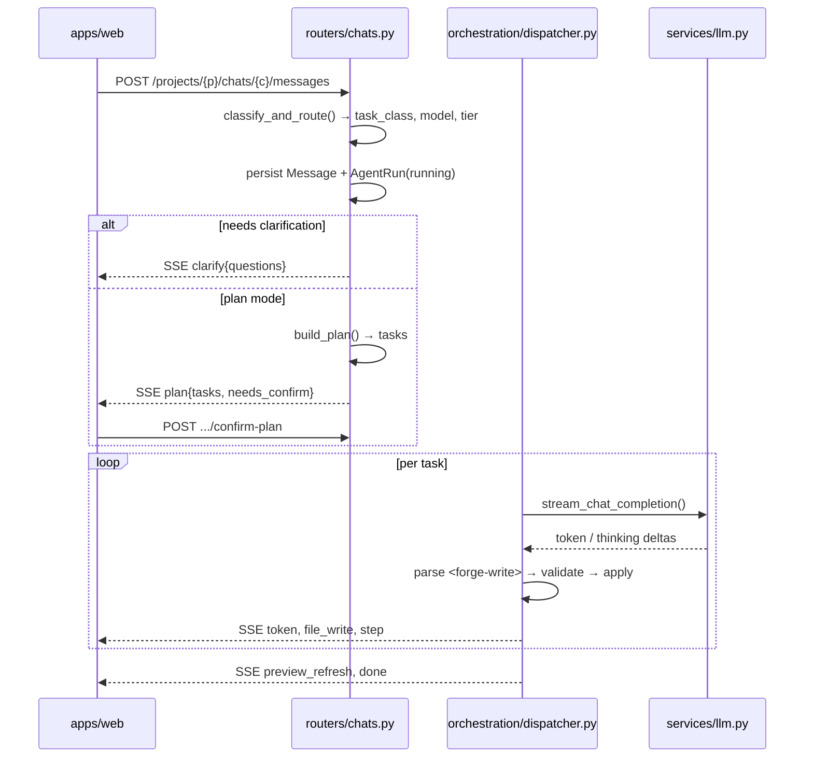

> 🇫🇷 [Version française](ARCHITECTURE.fr.md)

# Architecture

How Forge turns a chat message into a website, an app, a deck, a codelab or a
design system, and where each piece lives. Written for contributors: every
claim below points at a file you can open. This is an overview, not an API
reference.

## The short version

```
apps/web      Next.js 15 App Router: builder and editors UI, SSE consumer
apps/api      FastAPI: routing, agent orchestration, publishing, exports
  runtime/          Node + browser Babel/ESM toolchain (shared by preview AND publish)
  runtime/deck/     deck player bundle and PPTX writer (published decks, exports)
  runtime/codelab/  codelab player bundle (published codelabs, PDF export)
contracts/    forge-design/: JSON Schemas of the document kinds
data/         templates/ (86 starter kits) · integrations/ · projects/ (generated workspaces)
infra/        local Docker stack · CI helpers · AWS sites gateway
```

Supporting services: **Postgres**, **MinIO** (S3), **Valkey** (Redis), **Caddy**
(serves published sites). LLM calls go out to the RodiumAi gateway.

Three ideas explain most of the design:

1. **No build step for generated code.** Generated sites and apps are never
   compiled server-side while you work. The browser transforms them with Babel
   standalone and loads dependencies from a CDN import map. There is no
   `node_modules`, no Vite dev server.
2. **One manifest, two consumers.** `apps/api/runtime/packages.json` is the
   single source of truth for the import map, the import allowlist, and Monaco
   types. Preview and publish read the *same* file through the *same* resolver.
3. **Credentials stay out of the repo.** On Forge Cloud, generation uses the
   user's OAuth access token plus an API **key id**: the key secret never
   reaches this codebase. Self-host pastes a BYOK `rd_sk_…` key into settings
   (encrypted at rest); Cloud spends **FRODI** first, then **RODI**.

## Project kinds

`Project.platform` stores the kind. The registry is
`apps/api/app/kinds/__init__.py`, mirrored by `apps/web/lib/kinds.ts`:

| Kind | Engine | Editor | Publish mode | Exports | Flag |
|---|---|---|---|---|---|
| `web` | react | builder | `site` | zip | always on |
| `mobile` | react | builder | `site` | zip | always on |
| `slides` | document | deck | `deck_player` | pdf, png, pptx, html | `FORGE_KIND_SLIDES_ENABLED` |
| `codelab` | document | codelab | `codelab_player` | md, pdf, zip | `FORGE_KIND_CODELAB_ENABLED` |
| `design_system` | document | design_system | `design_system_site` | tokens, css, tailwind, md, pdf | `FORGE_KIND_DESIGN_SYSTEM_ENABLED` |

**React kinds** are code written by the agent (the sections from "A generation
run" to "Publishing" below). **Document kinds** are data validated against the
contracts in `contracts/forge-design/` (`deck.schema.json`, `slide.schema.json`,
`codelab.schema.json`, `design-system.schema.json`; Pydantic mirror in
`apps/api/app/contracts/forge_design.py`, TypeScript mirror in
`apps/web/lib/contracts/forge-design.ts`) and rendered by a fixed Forge player.
The model never writes code for them: it answers JSON or Markdown that the
server validates, repairs when needed, and writes.

The three document kinds **ship off**. Each flag defaults to `false`
(`apps/api/app/config.py`; commented out in `.env.example` and
`apps/api/.env.example`). `GET /kinds` (`app/routers/kinds.py`) tells the web
app which kinds are on. While a kind is off, creating a project of that kind
fails with `KIND_DISABLED`, its document and export routes answer 404, and its
starter kits stay out of the public template catalogue.

A new document project starts from `app/services/document_scaffold.py` (one
title slide, one intro step, or the default tokens, plus a `DESIGN.md`), or
from a starter kit (see [TEMPLATES.md](TEMPLATES.md)).

## A generation run, end to end

This section and the four after it describe the React kinds (`web`, `mobile`).



**Entry points.** The UI posts from `apps/web/app/projects/[id]/page.tsx` and
folds each event through `apps/web/lib/chat-stream.ts` (`reduceStreamEvent`
returns `{state, effects}`; the page performs the effects). The server side is
`apps/api/app/routers/chats.py` (`send_message`). A message on a document
project is handed to `start_document_message`
(`app/services/deck_ai/chat_entry.py`) before the site pipeline; otherwise one
of four branches runs: image, clarify, single-pass, or plan.

**Streaming.** Everything is SSE, wrapped by `with_sse_heartbeats`
(`apps/api/app/services/sse.py`), which emits `: hb <ts>` comments so a quiet
run is not cut by a proxy. Raise `ALB_IDLE_TIMEOUT_SECONDS` (default 600) to
match your load balancer.

**Event contract.** Every frame is `data: <json>`:

| `type` | Meaning |
|---|---|
| `user_message` | run id handshake |
| `route` | routing decision (task class, tier) |
| `step`, `plan`, `plan_task` | activity panel and plan checklist |
| `token`, `thinking` | assistant text / reasoning deltas |
| `clarify` | human-in-the-loop gate; releases the composer |
| `file_write`, `file_delete` | an op was applied |
| `preview_refresh` | emitted at task boundaries, not per write |
| `warning` | validator or verify finding |
| `error`, `done` | terminal |

**Reconnects are first class.** A run is produced by a background task, not by
the HTTP handler: closing the tab does not kill it. `GET .../runs/active`
restores HITL state and `GET .../runs/{id}/events?after=N` replays then tails.

**The LLM call** is plain `httpx` against an OpenAI-compatible
`/chat/completions`, with no vendor SDK. See `apps/api/app/services/llm.py`.

## The agent loop

**Forge does not use function calling.** The model writes XML tags in its normal
output and the server parses them (`apps/api/app/prompts/system.py` defines the
contract, `apps/api/app/services/tags.py` parses it):

```
<forge-write path="src/App.tsx"> …file contents… </forge-write>
<forge-edit path="src/App.tsx">
<<<<<<< SEARCH
exact current lines
=======
replacement lines
>>>>>>> REPLACE
</forge-edit>
<forge-delete path="src/Old.tsx"></forge-delete>
```

`forge-edit` applies search/replace hunks to the current file
(`services/edit_apply.py`: exact match, then a whitespace-tolerant line match,
never an ambiguous one); an edit that does not apply gets one focused retry with
the file shown in full.

**Output limits.** Every code stream sends `max_tokens` (the gateway otherwise
caps Claude/Gemini at 4096 output tokens) and reads `finish_reason`. An answer
cut by the limit, or a tag left open, is continued (`stream_with_continuation`
in `services/llm.py`): the re-emitted file wins over the cut one, and a file still
cut after the last round is reported to the user instead of vanishing.

A consequence worth knowing: **the agent does not choose which files to read.**
Context assembly is heuristic: `apps/api/app/services/orchestration/context.py`
selects files by relevance, forced paths, and the plan's declared `files`
(directories expand to their files), then layers the system prompt,
`AI_RULES.md`, a locked `DESIGN.md`, the project images with their real sizes, a
starter-kit excerpt as quality reference on young builds, file skeletons (CSS
files list their classes) and the selected bodies (160k characters, index.css
first). Older history is compacted by an LLM pass. The frontend-only rules and
the integrations catalog come from `services/prototype_mode.py`.

Phases: classify → optional clarify → plan → brand bootstrap (first build of a
blank project: `services/brand_charter.py` writes a DESIGN.md with a palette, a
validated Google Fonts pair and an imagery direction, then the first WebP images)
→ execute → verify/repair (on the model that wrote the code). Plans of four or
more tasks, and any scaffold, pause for user confirmation.
`apps/api/app/services/orchestration/dispatcher.py` runs tasks sequentially.

**CSS ownership is one rule everywhere**: `src/index.css` is the foundation,
written once by the styles_foundation task; each page owns
`src/styles/<page>.css`, scoped under its root class. Orphan classes are reported
against the component and its stylesheet.

**Writes are validated before anything touches disk**
(`apps/api/app/services/apply_writes.py`):

- A **git snapshot** is taken first: each project is its own private repo under
  `data/projects/{id}`, which is what powers history and rollback.
- Imports are checked against the manifest allowlist using **tree-sitter**
  (`services/import_validator.py`), falling back to regex when unavailable.
  Violations: `BUILD_FORBIDDEN_IMPORT`, `BUILD_INVALID_NAMED_EXPORT`.
- `DESIGN.md` and `public/logo.*` are brand-locked unless the request explicitly
  asks to change the brand; the placeholder charter of a blank scaffold is not a
  brand and is never locked.
- A full rewrite of `src/index.css` that drops rules keeps them (merge);
  deliberate removals go through `forge-edit`. Page stylesheets are owned by
  their task and rewritten freely.

## Preview

No dev server is ever started. `GET /runner/` renders a shell
(`apps/api/app/services/preview_babel.py`) that injects the import map, the
allowed parent origins, and Babel standalone. The UI then fetches the project's
source bundle and posts `{type:"forge:render", files, entry}` into the iframe.

Inside the iframe (`apps/api/runtime/`):

1. `transform.mjs`: Babel with the React automatic runtime + TypeScript presets.
2. Bare specifiers are checked against the document's own import map → `IMPORT_NOT_IN_MANIFEST`.
   Specifiers are collected with tight regexes (no quotes between `import`/`export`
   and `from`) plus a plausibility filter so Babel output fragments such as
   `/*#__PURE__*/_jsxs` or the word `from` inside a string like `"or start from"`
   are never treated as packages.
3. `topo.mjs`: topological sort, raising `CIRCULAR_DEPENDENCY` with the cycle.
4. `rewrite.mjs` + `resolve.mjs`: each specifier is rewritten to the dependency's already-created `blob:` URL. Resolution is **case-sensitive** and understands `@/` → `src/`.
5. `await import(entryBlobUrl)`. Old blobs are revoked on success, kept on failure so the error stays inspectable.

The import map is not mutable after load, which is why the project's own extra
dependencies must be injected at shell-render time (`?p=<uuid>`). Bump the
`?v=` query on `runner.js` / `bridge.js` in `preview_babel.py` whenever the
runner contract changes, or browsers keep a stale transform.

**During generation the builder hides the blocking Babel overlay**
(`PreviewPane` `suppressErrorOverlay` while `busy || streamActive`). Mid-plan
files are often briefly inconsistent; the overlay returns once the run settles
if the preview is still broken.

**Origin pinning is strict in both directions.** `RUNNER_PARENT_ORIGINS` builds
an allowlist; the runner refuses to send to anything else.

## Attachments, images, logos, and URL cloning

Prompt images carry an **intent** (`apps/web/lib/prompt-attachments.ts` +
`apps/api/app/services/attachments.py`):

| Intent | UI label (FR) | Effect |
|---|---|---|
| `reference` | Capture de référence | Vision-only; multi-page plans when ≥2 references |
| `asset` | Asset joint | Materialized under `public/` (logo → `public/logo.*`); the agent must use those paths and must not redraw the logo |

`reference` and `asset` **coexist** on the same message: a screenshot no longer
overwrites a logo.

If the user pastes a public site URL without enough reference shots, the API
captures desktop + mobile screenshots with Playwright
(`apps/api/app/services/url_capture.py`, wired in `routers/chats.py`) and appends
them as `intent:reference` markers before routing. Chromium is installed in the
API image (`playwright install --with-deps chromium`).

**Image panel and the free image bank.** `app/routers/images.py` serves the
image panel of the builder and of the deck editor: upload, AI generation, and a
search in a free image bank (`GET /images/search`, `services/image_bank.py`).
The bank is Pixabay and is optional: it needs `PIXABAY_API_KEY` on the server
(the key never reaches the browser); without it the search answers 503. Results
are cached 24 hours (Valkey, or an in-process store), and an image the user
keeps is downloaded into the project (`public/images/`), never hotlinked.

## Publishing

`POST /projects/{id}/publish` (`app/routers/publish.py`) picks the build from
the kind's publish mode. Every mode uploads to the same bucket under `{slug}/`,
behind the same gateway and custom domains. For sites and apps it calls
`apps/api/app/services/publish_esm.py`:

1. **Production build.** `node apps/api/runtime/cli.mjs` (project on stdin)
   runs the *same* Babel transform as the preview, then esbuild
   (`runtime/build.mjs`) bundles the app and its dependencies (fetched once
   from esm.sh, cached on disk), tree-shakes (lucide-react comes from the npm
   package), minifies and content-hashes `assets/*.js`, with `modulepreload`
   links and no source maps. If the CDN is unreachable, dependencies stay
   external behind an import map limited to what the app imports. All CSS is
   minified into one `<style>` (`src/index.css` first); web-font `@import`s
   become `<link>` + preconnect. Assets imported from code are copied;
   oversized images are resized and recompressed in place.
2. **Pre-render** (`services/prerender.py`): headless Chromium loads the build
   from disk (no other network), follows the site's own links, and saves each
   route as `<route>/index.html` with its markup, title and the tags pages set
   through react-helmet-async; `404.html` is rendered from an unknown path.
3. **SEO** (`services/site_seo.py`): `<html lang>` detected from the text,
   per-page canonical and og:url, absolute og/twitter images, og:site_name,
   og:locale, schema.org WebSite on the home page, `sitemap.xml` and
   `robots.txt` (unless the project ships its own).
4. **Upload** under `{slug}/` with `Cache-Control` (hashed assets immutable,
   pages revalidated), pages last, then stale keys are removed.

Caddy is a **pure reverse proxy to the bucket** (`infra/local/Caddyfile`,
`infra/aws/sites-gateway/Caddyfile`, one shared snippet): `/` serves
`index.html`; a file path serves the file or a plain 404; a page path serves
`<page>/index.html`, else `404.html` **with status 404**, else `index.html`
(sites published before pre-rendering). 403 counts as missing. Responses are
compressed (zstd/gzip); SVGs render as images but are sandboxed when opened.

A published site is static: the gateway never forwards anything from it to the
API. Forms and analytics are integration-catalog embeds (see
[INTEGRATIONS.md](INTEGRATIONS.md)). Pre-rendering runs in a child process with
a scrubbed environment and a hard deadline (`services/prerender.py`).

`/v1/authorize-host` exists **only for custom domains**: Caddy's `forward_auth`
asks the API whether a hostname maps to a validated `ProjectDomain`, and gets
back the slug to rewrite to. The slug always stays the S3 key; a custom domain
changes routing, never storage.

## Slides

A deck is `deck.json` (format, theme, the ordered slide list with layout and
transition), one `slides/<id>.json` per slide (positioned elements on a 1920 x
1080 canvas for 16:9; 4:3 and 1:1 also exist), `notes/<id>.md` speaker notes,
images under `public/images/`, and `DESIGN.md`, whose `--token` colour lines and
font lines are the theme. Slides reference colours as tokens (`--accent`), so a
theme change restyles the whole deck.

| Where | What |
|---|---|
| `apps/web/components/deck-editor/` | editor: canvas, slide rail, layers and properties panels, image panel, deck chat with voice input, publish menu, autosave |
| `apps/web/components/deck-player/` | the player (slides, animations, morph transitions, presenter view); one source for the editor, the published page and the exports |
| `apps/web/components/deck-exports/` | export menu |
| `apps/api/app/routers/documents.py` | read and write `deck.json`, slides and notes (each write validated) |
| `apps/api/app/services/deck_ai/` | chat flows, outline, layouts, targeting, themes, visuals |
| `apps/api/app/prompts/deck.py` | prompts of the slides AI |
| `apps/api/app/services/exports/` | deck publishing, exports, plan gating |
| `apps/api/runtime/deck/` | esbuild bundle of the player, print and layout extraction pages, PPTX writer (pptxgenjs) |

**How the AI edits a deck** (`services/deck_ai/flow.py`). A new deck starts
with an outline: each slide becomes a plan task the user confirms or edits
(`deck.outline` event), then a background job writes the slides one by one,
reconnectable like a site build. A message that targets a slide or an element
(or a quick action) is one edit restricted to that target, enforced
server-side (`targeting.py`): whatever the model returns, only the target is
taken from its answer. Anything else is a deck-level edit (add, remove,
reorder, restyle). Every answer is one JSON object, validated and repaired by
`deck_ai/llm.py`; layouts come from `layouts.py`, allowed tokens from
`theme.py`. Image placeholders are filled by `visuals.py`: free image bank
first, an AI image only when the user asked for generated images, and the
placeholder is removed when neither works. Pictures attached in the deck chat
are uploaded into the project; PDF and PowerPoint files are read in the
browser (`deck-editor/document-import.ts`) and their text is sent with the
message.

**Publish and export.** `services/exports/deck_publish.py` uploads the player
bundle (built by `runtime/deck/build.mjs` with only the icons the deck uses),
the deck documents and images, plus a presenter view synced with the audience
window over a `BroadcastChannel` (no server). Speaker notes are published only
when the owner chooses to. Exports go through `POST /projects/{id}/exports/{fmt}`
(`services/exports/deck_exports.py`):

| Format | How |
|---|---|
| `pdf` | the print page rendered by Chromium in a child process (`render.py`), vector text, optionally one page per animation step |
| `png` | one image per slide, zipped |
| `html` | one self-contained file (player, documents, images), works offline |
| `pptx` | Chromium reads the layout (`runtime/deck/src/extract.ts`), Pillow prepares the images, `runtime/deck/pptx.mjs` writes native PowerPoint; warnings (fonts to install, elements exported as pictures) come back in `X-Forge-Export-Warnings` |

## Codelabs

A codelab is `codelab.json` (title, summary, level, prerequisites, what you
learn, steps with their minutes, downloads), one extended Markdown file per
step under `steps/`, and downloadable files under `files/` (typically
`files/starter/` and `files/solution/`).

| Where | What |
|---|---|
| `apps/web/components/codelab-editor/` | editor: steps, details, files panel, chat, publish menu |
| `apps/web/components/codelab-player/` | the player (cover, steps, extended Markdown, code highlighting) |
| `apps/api/app/routers/documents.py`, `app/routers/codelab.py` | codelab and step documents; files, claat import, Markdown, sources ZIP and PDF exports |
| `apps/api/app/services/codelab/` | flows, outline, prompts, files policy, Markdown import/export, publishing, PDF |
| `apps/api/runtime/codelab/` | esbuild bundle of the player (`build.mjs`, output in `dist/`) |

**How the AI edits a codelab** (`services/codelab/flow.py`). Same shape as the
deck: a new codelab starts with an outline the user confirms, then a
background job writes the steps one by one, each streamed to the editor. A
message that targets a step rewrites that step only (the model sees the
others read-only). Two actions do not rewrite steps: `check_code` reviews code
consistency across steps, `make_files` writes starter and solution files and
their download entries. Anything else is a codelab-level edit.

**Files.** `services/codelab/files.py` applies the upload limits and refuses
native executables and installers, by extension and by magic bytes. Forge
never runs these files.

**Import and export.** `services/codelab/markdown_io.py` imports and exports
the Google Codelabs (claat) Markdown format, so an exported codelab imports
back. Exports: Markdown, a ZIP of the sources, and a PDF
(`services/codelab/pdf.py`: the published player in print mode, printed by
Chromium in a child process).

**Publish.** `services/codelab/publish.py` uploads the prebuilt player from
`runtime/codelab/dist`, a `codelab-data.json` (codelab, steps, DESIGN.md,
downloads), the step images, the files and one ZIP per download marked
`zip: true`. No server code runs for a published codelab. In a checkout,
build the player once with `npm run build:codelab-player` in `apps/web`;
publishing and the PDF export fail with a clear message until it exists.

## Design systems

A design system is `design-system.json` (W3C-style tokens: colour, font,
weight, text, leading, type, space, radius, shadow, motion, ease, icon; plus
logo, voice, imagery, guidelines and components), the brand files under
`public/brand/`, and a generated `DESIGN.md`.

| Where | What |
|---|---|
| `apps/web/components/design-system/` | editor, chat, component showcase, exports, picker and link card for other projects |
| `apps/api/app/routers/documents.py`, `app/routers/design_systems.py` | the document; list, defaults, team sharing, project links, exports, logo upload |
| `apps/api/app/services/design_system/` | tokens, generation, website extraction, rendering, brand guidelines, registry, sync, gating |

**How the AI writes one** (`services/design_system/flow.py`). The model never
writes tokens by hand: it answers a compact spec (palette by role, three font
families from the curated list, type scale, spacing, radii, shadow, motion,
guidance) and `tokens.py` builds the document, checks the WCAG contrast of the
pairs that matter and repairs the ones that fail. A message holding a public
URL also reads that site's palette, fonts, radii and spacing in Chromium
through the SSRF guard (`site_extract.py`); an attached image is read as the
logo. A message that targets one section rebuilds that section only and leaves
the rest, hand edits included, untouched.

**Rendering, publish and exports.** `render.py` writes `DESIGN.md` (what the
agent and the players read), `tokens.json`, CSS variables and a Tailwind
config. `site.py` renders the brand guidelines page from the tokens (no
script); it is the published site. `guide.py` renders the brand guidelines as
Markdown and as an A4 landscape PDF printed by Chromium, which may only fetch
Google Fonts.

**How projects follow a design system.** A design system is a `design_system`
project plus a row in `design_systems` (`services/design_system/registry.py`):
owner, optional team sharing, personal and team defaults, and a `version` that
moves on each time `design-system.json` changes. A site, app, deck or codelab
links to one through `projects.design_system_project_id` and remembers the
version last applied in `projects.design_system_version`. Applying is explicit
(`services/design_system/sync.py`): sites and apps get a regenerated DESIGN.md
and updated variables and font import in `src/index.css`; decks and codelabs
get a regenerated DESIGN.md (their players read the theme from it). When the
design system moves on, the link reports the newer version and its changes,
and nothing changes until the user confirms the resync
(`POST /projects/{id}/design-system-link/resync`).

## Plan gating on Forge Cloud

Open-source and BYOK installs have no entitlement cache: nothing below applies
to them. On Forge Cloud, the plan synced from the RodiumAi control plane
decides which starter kits can start a project (`services/template_gating.py`),
who may create and share design systems (`services/design_system/gating.py`)
and which export formats are open (`services/exports/gating.py`,
`services/codelab/exports.py`, `services/design_system/exports.py`). A refusal
answers 403 with the plan that unlocks the feature.

## Data model

`apps/api/app/models.py`, SQLAlchemy 2.0 on Postgres. The core chain is
`User → Project → Chat → Message`, with `AgentRun` recording each generation
(status, plan, clarify answers, and `cursor_task_index` so a run can resume).
`UserSettings` holds encrypted RodiumAi tokens. `ProjectDomain`, `StoredObject`,
`SiteUsageDay`, `PreviewComment`, `ModelCatalog`, `ForgeEntitlementCache` and
`DesignSystemRecord` (table `design_systems`) round it out. `Project.platform`
holds the kind; `design_system_project_id` and `design_system_version` link a
project to a design system. `forge_entitlement_cache` also carries the export
and design system sharing rights.

**There are no migration files.** `apps/api/app/db.py` (`init_db`) runs
`create_all()` followed by a hand-written list of idempotent statements
(`CREATE TABLE IF NOT EXISTS`, `ADD COLUMN IF NOT EXISTS`, …), run from the
FastAPI lifespan at startup and from `make migrate`. There is **no rollback
path and no version table**: add schema changes as new idempotent statements,
and expect to handle backfills yourself.

## Authentication

Two independent layers (plus optional Cloud entitlements):

- **Local Forge accounts.** `POST /auth/register` creates an email/password
  user (HTTP 201). The session JWT is HS256 over `SECRET_KEY` (7 days).
  `get_current_user` accepts Bearer *or* `?access_token=` so `` loads
  work. Optional Google uses Firebase ID tokens.
- **RodiumAi OIDC.** Authorization code + PKCE (`services/rodium_oidc.py`).
  Appears only when `RODIUM_OIDC_CLIENT_ID` is set; otherwise
  `/auth/rodium/start` returns 503 and the UI hides the button. Access/refresh
  tokens are Fernet-encrypted in `user_settings`.
- **Forge Cloud entitlements.** When `forge_cloud_enabled` is true (OIDC +
  Forge scopes), the API pulls plan/FRODI from the RodiumAi control plane
  (`GET …/internal/forge/balance`), caches them, and exposes
  `GET /auth/forge/status`. **FRODI** is the primary reservoir; **RODI** is the
  wallet fallback. Plan grants live in the control plane, not in this repo.

`resolve_generation_auth` (`services/rodium_generation.py`) runs at the top of
every generation endpoint. On the Cloud path, chat and image calls go to the
gateway's public `/v1` with **the user's own RodiumAi access token**
(`RODIUM_GATEWAY_URL`, default `RODIUM_BASE_URL`): the gateway bills the
token's owner, FRODI first, then RODI. An expired token is refreshed; a missing
one is minted again through provisioning, and a verified Forge account without
a RodiumAi account gets one on its first generation. Self-host / legacy can
decrypt a pasted key instead.

During the transition the internal Forge lane (`/internal/forge/*`, shared
token) is still used when the gateway refuses a token or Forge has none
(`FORGE_INTERNAL_LANE_FALLBACK=false` turns that off), and for shared projects
billed to their owner, whose per-collaborator FRODI ceiling only that lane
enforces. Plan and balance reads still go through it too.

> Self-host does **not** require OIDC. Local `/register` works with an empty
> `RODIUM_OIDC_CLIENT_ID`. Forge Cloud (`forge.rodiumai.io`) uses RodiumAi SSO
> and FRODI/RODI plans managed by the RodiumAi control plane.

## Background work

**Everything runs in the API process.** `spawn_plan_job` creates an
`asyncio.Task`, and the deck and codelab write jobs do the same; the HTTP
handler only relays from a buffer. There is no worker container, and
`docker-compose.yml` defines none. Chromium work (pre-render, PDF, PNG and PPTX
exports) runs in child processes with a hard deadline.

Valkey/Redis is used for the run event log (24h TTL, the durable replay buffer),
a run claim key, a cancellation flag and the image bank cache. **It is
optional**: every helper degrades to an in-process mirror when Redis is
unreachable, because a down Valkey used to produce a silent infinite spinner.

## The API image

`apps/api/Dockerfile` installs Node 22 and Chromium next to Python, then builds
the runtimes: `runtime/` (Babel standalone for the preview), `runtime/deck/`
(its own pinned React, framer-motion, lucide-react and pptxgenjs; the player
source is copied from `apps/web/components/deck-player`) and `runtime/codelab/`
(the player is bundled once into `runtime/codelab/dist` from
`apps/web/components/codelab-player`).

## Rough edges worth knowing

Honest notes for anyone reading the code and wondering:

- `forge:plan:queue` is pushed to but **never popped**: a placeholder for a
  future worker that does not exist yet.
- `providers/keys.py` and `providers/secrets.py` are complete but have **no
  importers** outside the `providers` package; the encryption actually in use
  is Fernet in `app/crypto.py`. Production config still asserts KMS/Secrets
  Manager.
- `providers/queue.py` defines a full Redis Streams usage queue that nothing
  publishes to or consumes; `SiteUsageDay` is written synchronously instead.
- `Project.preview_port` / `preview_running` are vestigial from a Vite-dev-server
  era.
- `apps/web/lib/preview-host.ts` rewrites to `/preview-by-slug/{slug}`, for which
  **no FastAPI route exists**: locally Caddy serves those hosts from MinIO. It
  looks like a leftover from the pre-Caddy architecture.

## Where to go next

- [CONTRIBUTING.md](../CONTRIBUTING.md): setup, checks, PR process
- [TEMPLATES.md](TEMPLATES.md): the starter kit authoring contract, per kind
- [INTEGRATIONS.md](INTEGRATIONS.md): the embed catalog contract
- [DOCKER.md](../DOCKER.md): local stack, ports, preview notes
